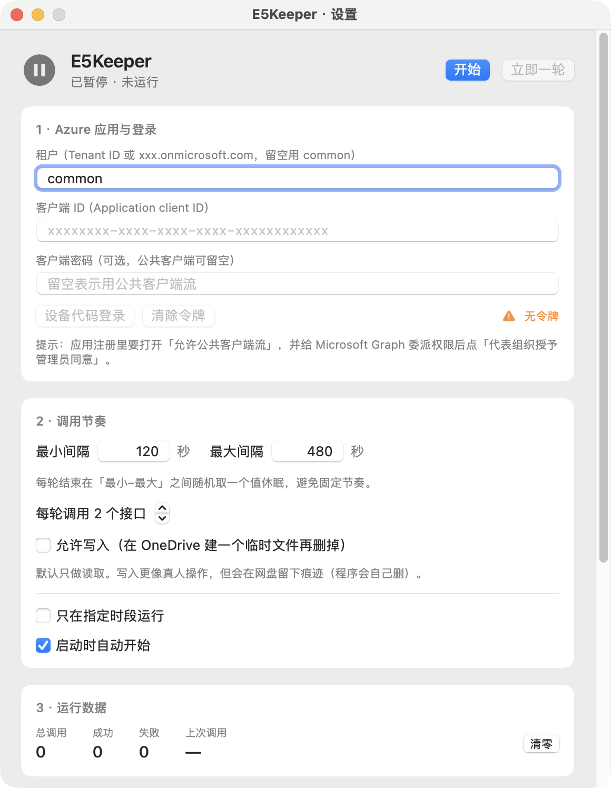

# E5Keeper

macOS 上的 Microsoft 365 E5 开发者订阅保活工具。SwiftUI 菜单栏应用，1.7 MB，不需要 Docker、不需要运行时。



E5 Renew Plus 只有 Windows 版且未开源，E5 Renew X 的 C# 源码要装 .NET 或上 Docker。这个是把核心保活逻辑用原生代码重写。

## 功能

- 每轮随机调 1–8 个 Graph 接口，间隔 120–480 秒随机
- 43 个只读接口，顺序、间隔、个数都随机
- 写入模式：在 OneDrive 建临时文件再删掉（默认关）
- 只在指定时段运行（可选）
- 设备代码登录，refresh_token 自动轮换
- 连续 3 次鉴权失败自动暂停
- 菜单栏显示运行 / 暂停状态

## 上手

**1. 注册 Azure 应用**

打开 <https://entra.microsoft.com> → 应用注册 → 新注册。账户类型选「仅此组织目录中的账户」，重定向 URI 留空。

注册完做三件事：

- 「身份验证」→ 允许公共客户端流 = 是
- 「API 权限」→ Microsoft Graph → 委派权限，勾 `User.Read`、`User.Read.All`、`Files.Read.All`、`Mail.Read`、`Calendars.Read`、`Contacts.Read`、`Notes.Read`、`Tasks.Read`、`Sites.Read.All`、`Directory.Read.All`，然后点「代表组织授予管理员同意」
- 记下「概述」里的应用程序(客户端) ID 和目录(租户) ID

**2. 填进 app**

首次启动会自动弹设置窗口。填租户和客户端 ID，点「设备代码登录」。

**3. 浏览器授权**

打开 <https://microsoft.com/devicelogin>，粘贴窗口里的代码，用 E5 账号登录并同意。

## 编译安装

```bash
cd E5Keeper
./install.sh        # 编译 + 装到 /Applications + 启动
```

只要产物不安装：`./build.sh`，产物在 `build/E5Keeper.app`。

需要 macOS 14+ 和 Xcode / Command Line Tools。ad-hoc 签名，不需要开发者账号。开机自启：把 `/Applications/E5Keeper.app` 加进「系统设置 → 通用 → 登录项」。

## 目录

```
E5Keeper/
├── Sources/
│   ├── App.swift          # 入口、菜单栏、设置窗口
│   ├── Engine.swift       # 调度循环、OAuth、调用
│   ├── GraphAPI.swift     # 接口池与 HTTP
│   ├── SettingsView.swift # 设置界面
│   ├── Store.swift        # 本地存储
│   ├── Models.swift       # 数据结构
│   └── Snapshot.swift     # --snapshot 离屏渲染
├── Info.plist
├── make_icon.swift
├── build.sh
└── install.sh
```

非官方工具，与 Microsoft 无关。MIT License。
